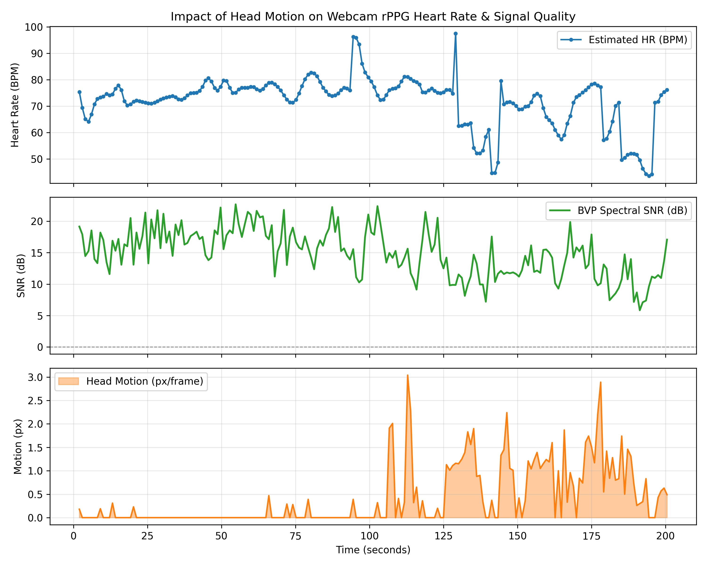

# Real-Time Webcam rPPG Heart Rate Estimation & Motion-Artifact Analysis

A real-time remote photoplethysmography (rPPG) pipeline built in Python to extract Blood Volume Pulse (BVP) waveforms, estimate heart rate (BPM), and quantitatively evaluate motion-induced signal degradation via standard webcam video.

## Motivation
Camera-based physiological sensing suffers significantly from motion artifacts during natural head movements. Inspired by mobile and wearable biosignal research, this mini-study benchmarks real-time rPPG heart rate stability and spectral Signal-to-Noise Ratio (SNR) across stationary and dynamic head-motion conditions.

## Key Features
- **Real-Time BVP & Heart Rate Tracking:** Uses `open-rppg` and `OpenCV` to extract facial BVP signals and compute live heart rate (BPM).
- **Motion Artifact & Spectral SNR Quantification:** Tracks frame-to-frame facial bounding-box displacement (`px/frame`) alongside FFT-based BVP spectral SNR (`0.75–3.0 Hz` cardiac band).
- **Privacy-Preserving Visualization Mode:** Real-time Gaussian face-blurring toggle (`[b]`) for anonymized demonstration and data collection.
- **Automated Telemetry & Plotting:** Logs second-by-second experimental phases (`[1]` Stationary vs. `[2]` Motion) to CSV and generates multi-panel time-series plots.

## Experimental Results
A 200-second recording was conducted across two phases:
1. **Stationary Baseline (0–100s):** Minimal head displacement (`< 0.3 px/frame`) yielded stable heart rate estimates (`70–80 BPM`) and high BVP spectral SNR (`14–22 dB`).
2. **Controlled Head Motion (100–200s):** Periodic head movements (`up to 3.0 px/frame`) degraded spectral SNR (`6–12 dB`) and induced substantial heart rate estimation errors (`45–98 BPM`).



## Quick Start
```bash
pip install opencv-python numpy pandas matplotlib open-rppg
python mainrun.py
python plot_analysis.py
